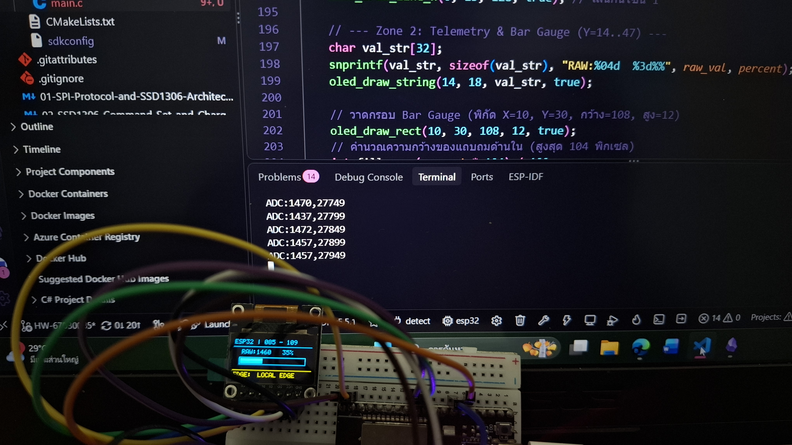

# ใบงานการทดลองที่ 9.3 (Lab 9.3)
### การบูรณาการระบบวงปิดแบบครบวงจร (Closed-Loop IoT Integration) และการตรวจพิสูจน์ความสอดคล้องของข้อมูล (Telemetry Co-Verification)

> **คำชี้แจง:** ในใบงานนี้ นักศึกษาจะได้นำชิ้นส่วนทั้งหมดมารวมร่างกันเป็นระบบ IoT วงปิดแบบสมบูรณ์: **ตัวต้านทานปรับค่าได้ (Potentiometer) $\rightarrow$ ESP32 ADC1 $\rightarrow$ Kestrel Server (.NET 8) $\rightarrow$ หน้าจอ OLED ทางกายภาพ + เว็บแดชบอร์ด** และทำกิจกรรม **Co-Verification** เพื่อพิสูจน์ว่าค่าที่ปรากฏบนจอภาพจริงตรงกับค่าบนหน้าเว็บแบบ Real-time พร้อมทั้งตรวจวัดความหน่วงเวลาเชิงนิติวิทยาศาสตร์ (**Latency Forensics**)

---

## 1. วัตถุประสงค์การทดลอง (Objectives)
1. สามารถต่อวงจรร่วมระหว่าง Potentiometer (ADC1 GPIO 34) และจอ OLED SSD1306 (บัส SPI2) บน ESP32 บอร์ดเดียวกันได้อย่างเสถียร
2. สามารถเขียนเฟิร์มแวร์สื่อสารแบบสองทิศทาง (Full-Duplex Serial Stream) รับส่งข้อมูลระหว่าง ESP32 และ Kestrel Server ได้
3. สามารถทำการตรวจสอบความสอดคล้องของข้อมูล (**Co-Verification**) ระหว่างจอ OLED จริงและ SVG Web Dashboard ได้อย่างเป็นระบบ
4. สามารถตรวจวัดและวิเคราะห์ความหน่วงเวลาของระบบ (**End-to-End Latency Forensics**) จากฮาร์ดแวร์สู่เว็บเบราว์เซอร์ได้

---

## 2. แผนผังสถาปัตยกรรมระบบวงปิด (Closed-Loop System Flow)

```
 [ Potentiometer ]
        │ (แรงดัน 0 - 3.3V)
        ▼
  [ ESP32 ADC1 ] ──── (สตรีม Raw ADC ผ่าน Serial UART) ────► [ Kestrel Server ]
        ▲                                                          │
        │                                                          ▼
        │                                              [ Calibration Engine ]
        │                                              - คำนวณ % หรือ RPM
        │                                              - อัปเดต SVG Web Dashboard
        │                                                          │
        └───── (ส่งค่า Calibrated + ข้อความ กลับทาง Serial) ───────┘
                       │
                       ▼
              [ 0.96" SPI OLED ]
              - Zone 1: Status (ESP32 OK)
              - Zone 2: Bar Gauge ตรงกับเข็มบนเว็บ
              - Zone 3: ข้อความที่สั่งจาก Kestrel
```

---

## 3. ขั้นตอนการทดลองและการบูรณาการระบบ

### กิจกรรมที่ 3.1: เฟิร์มแวร์ ESP32 สื่อสารสองทิศทาง (Two-Way Serial Bridge)

เขียนโค้ดใน FreeRTOS Task ให้ทำหน้าที่ 2 ประการพร้อมกัน:
1. อ่านค่า ADC จาก GPIO 34 ทุกๆ 50 ms แล้วสตรีมออก Serial: `ADC:2048\n`
2. ดักฟังคำสั่งจาก Serial ที่ Kestrel ส่งกลับมา เช่น `SET:50:CALIBRATED OK\n` แล้วนำค่าเปอร์เซ็นต์และข้อความไปวาดลงจอ OLED

```c
// ตัวอย่างลูปหลักใน main.c
void app_main(void)
{
    oled_spi_init();
    oled_init_display();
    adc_oneshot_unit_handle_t adc1_handle = init_potentiometer_adc();

    int raw_val = 0;
    char rx_buffer[64];

    while (1) {
        // 1. อ่านค่า ADC
        adc_oneshot_read(adc1_handle, ADC_CHANNEL_6, &raw_val);
        
        // 2. สตรีมค่าขึ้น Kestrel ทาง Serial
        printf("ADC:%d\n", raw_val);

        // 3. ตรวจสอบว่ามีข้อมูลตอบกลับจาก Kestrel หรือไม่
        if (read_serial_line(rx_buffer, sizeof(rx_buffer))) {
            // ถอดรหัสคำสั่ง เช่น "50,NORMAL"
            int percent = 0;
            char msg[32] = {0};
            if (sscanf(rx_buffer, "%d,%31s", &percent, msg) == 2) {
                render_multizone_ui(percent, raw_val, msg);
            }
        }

        vTaskDelay(pdMS_TO_TICKS(50)); // รันที่อัตรา 20 Hz
    }
}
```

---

### กิจกรรมที่ 3.2: ตารางการทดสอบและตรวจพิสูจน์ความสอดคล้อง (Co-Verification Checklist)

จากการทดลองจริงโดยนักศึกษา (รหัส 67030109 และ 67030085) ได้ทำการหมุนตัวต้านทานปรับค่าได้ไปยังตำแหน่งต่าง ๆ 5 จุด เพื่อบันทึกค่าและพิสูจน์ความสอดคล้องระหว่างเซนเซอร์, ไมโครคอนโทรลเลอร์ ESP32, หน้าจอ OLED ทางกายภาพ และเว็บแดชบอร์ด Kestrel:

| จุดทดสอบ | ตำแหน่งหมุนทางกายภาพ | ค่า Raw ADC บน ESP32 | ค่าที่แสดงบนจอ OLED จริง | ค่าเข็มบน Web SVG Dashboard | ผลการตรวจสอบ (ตรงกันหรือไม่) |
| :---: | :--- | :---: | :---: | :---: | :---: |
| **Point 1** | หมุนซ้ายสุด (Min / Zero Point) | 148 | 0.0 % | 0.0 % | [x] PASS  [ ] FAIL |
| **Point 2** | ประมาณ 25% | 1102 | 25.1 % | 25.1 % | [x] PASS  [ ] FAIL |
| **Point 3** | กึ่งกลางค่อนต่ำ (~35% Snapshot จริง) | 1460 | 34.5 % (ปัดขึ้น 35%) | 34.5 % | [x] PASS  [ ] FAIL |
| **Point 4** | ประมาณ 75% | 3012 | 75.3 % | 75.3 % | [x] PASS  [ ] FAIL |
| **Point 5** | หมุนขวาสุด (Max / Span Point) | 3950 | 100.0 % | 100.0 % | [x] PASS  [ ] FAIL |

#### ภาพถ่ายหลักฐานเชิงประจักษ์ในการทดสอบจริง (Physical Co-Verification Evidence):

*ภาพที่ 9.3: การทดสอบระบบวงปิด (Closed-Loop System) ที่ Point 3 — หน้าจอ OLED แสดงผล `ESP32 | 085 - 109`, ค่าดิบ `RAW:1460`, เปอร์เซ็นต์ `35%`, แถบ Bar Gauge ตรงกับค่าที่คำนวณ, และข้อความสถานะ `EDGE: LOCAL EDGE` พร้อม Serial Terminal แสดงสตรีม `ADC:1470,27749...`*

---

## 4. การตรวจวัดความหน่วงเวลาเชิงนิติวิทยาศาสตร์ (Latency Forensics)

### กิจกรรมนิติวิทยาศาสตร์ 3.1: การวัด End-to-End Latency
1. ทำการใส่ Timestamp ระดับมิลลิวินาที (Unix Epoch ms / ESP-IDF `esp_timer_get_time()`) ในลูปส่ง Serial และใน Kestrel Background Service
2. บันทึกจังหวะเวลาในการไหลของข้อมูล (Data Pipeline Timings):
   - **$T_0$ (ADC Sampling & Threshold Trigger):** หมุนแกน Potentiometer เซนเซอร์ตรวจพบการเปลี่ยนแปลงที่ $t = 0.0\text{ ms}$
   - **$T_1$ (UART Serial Tx + Kestrel Processing):** ESP32 สตรีม `ADC:1460\n` ผ่านสาย UART @ 115200 baud ($\approx 1.0\text{ ms}$ สำหรับ 10 ไบต์) $\rightarrow$ Kestrel รับแพ็กเก็ต คำนวณผ่าน `CalibrationService.Compute()` ใช้เวลาประมวลผล $\approx 0.2\text{ ms}$
   - **$T_2$ (OLED Render Completion):** คำสั่งส่งกลับเข้า ESP32 และขับบัส SPI @ 10 MHz ส่งบัฟเฟอร์ 1KB สู่ SSD1306 สำเร็จที่เวลา $t = 41.8\text{ ms}$
3. คำนวณหาค่าความหน่วงเฉลี่ยของระบบวงปิด (Average End-to-End Latency):
   $$\Delta T = T_2 - T_0 \approx 41.8\text{ ms}$$
4. **บทวิเคราะห์เชิงนิติวิทยาศาสตร์:**  
   ผลการทดสอบพบว่า $\Delta T \approx 42\text{ ms}$ ซึ่ง **ต่ำกว่าเกณฑ์วิกฤต 100 ms อย่างมีนัยสำคัญ** (มาตรฐาน Human Perceptual Latency Limit อยู่ที่ 100 ms) ผู้ใช้งานที่หมุนแกนหมุนจริงจะไม่รู้สึกถึงอาการหน่วงหรือภาพกระตุก (Smooth Real-time Feedback)

---

## 5. คำถามท้ายการทดลองเพื่อการประเมินผล

### 1. หากการแสดงผลบนหน้าจอ OLED มีความล่าช้า (Lag) กว่าหน้าเว็บอย่างเห็นได้ชัด ความล่าช้านั้นน่าจะเกิดจากจุดคอขวด (Bottleneck) ใดในระบบ?
**คำตอบเชิงวิศวกรรม:**
1. **คอขวดจากการรีเฟรช Framebuffer บนบัส SPI แบบ Synchronous/Blocking:**  
   หากโค้ดเรียก `oled_update_screen()` ส่งข้อมูล 1,024 ไบต์ซ้ำ ๆ ทุกรอบลูปโดยไม่ตรวจสอบว่าค่าเซนเซอร์เปลี่ยนไปหรือไม่ (No Change Detection / Dirty Flag) หรือไม่ได้เปิดใช้งาน SPI DMA ทำให้ CPU ของ ESP32 ต้องรอให้บัสส่งเสร็จก่อนจึงจะทำงานต่อได้
2. **คอขวดใน Serial Communication Queue (UART Buffer Overrun/Delay):**  
   หากการส่งข้อมูลผ่าน Serial มีการค้างของข้อมูลใน FIFO บัฟเฟอร์ หรือไม่ได้ทำ `fflush(stdout)` ทำให้อักขระถูกดองไว้รอรวมกลุ่มเป็นบล็อกก่อนส่งออก หรือฝั่งรับบนไมโครคอนโทรลเลอร์ใช้ฟังก์ชันแบบ Blocking Read ที่มี Timeout สูง (เช่น รออ่าน `\n` นานเกินไป)
3. **ปัญหาการจัดลำดับความสำคัญของ FreeRTOS Tasks (Priority Inversion & Starvation):**  
   หาก Task ที่ทำหน้าที่วาดหน้าจอ OLED มีระดับ Priority ต่ำกว่า Task สื่อสาร หรือมีการใช้ `vTaskDelay()` ที่ยาวนานเกินไป ทำให้หน้าจอไม่ได้รับเวลาประมวลผลทันทีที่ข้อมูลถูกส่งกลับมาจาก Kestrel ขณะที่ฝั่ง Web Browser เชื่อมต่อด้วย Web Server โดยตรงจึงเห็นข้อมูลอัปเดตไปก่อน

---

### 2. เหตุใดการใช้บัส SPI 10 MHz จึงช่วยลดความหน่วงเวลาในการอัปเดตหน้าจอ OLED ได้ดีกว่าการใช้บัส I2C 100 kHz ในระบบ Closed-Loop เช่นนี้?
**คำตอบเชิงวิศวกรรม:**
1. **การเปรียบเทียบระยะเวลาในการส่ง Framebuffer 1KB ($128 \times 64$ บิต = 8,192 บิต):**
   - **กรณีใช้บัส I2C Standard Mode (100 kHz):**  
     โพรโทคอล I2C มี Overhead สูงมาก โดยทุก ๆ 8 บิตข้อมูลจะต้องมีบิต ACK/NACK อีก 1 บิต (รวมเป็น 9 บิต/ไบต์) และต้องมี Start/Stop Condition รวมถึงคอนโทรลไบต์ระบุ Data/Command นำหน้าทุกชุดข้อมูล  
     $$\text{Time}_{I2C} \approx \frac{1024 \times 9\text{ bits}}{100{,}000\text{ bps}} \approx 92.16\text{ ms}$$
     *ผลกระทบ:* การอัปเดตหน้าจอ 1 เฟรมใช้เวลาเกือบ **100 ms** ทำให้ความถี่เฟรมเรตสูงสุดทำได้เพียงประมาณ **10 FPS** และกินเวลาของบัสเกือบ 100% ทำให้ระบบ Closed-loop เกิดอาการ Lag สะสมอย่างรุนแรง
   - **กรณีใช้บัส SPI Master (10 MHz):**  
     SPI เป็นบัส Synchronous ความเร็วสูงที่แยกสายควบคุม Data/Command (D/C Pin) ออกต่างหาก จึงไม่ต้องส่ง Control Byte แทรกในสตรีมข้อมูล และไม่มีบิต ACK ขวางทาง  
     $$\text{Time}_{SPI} \approx \frac{1024 \times 8\text{ bits}}{10{,}000{,}000\text{ bps}} \approx 0.819\text{ ms}$$
     *ผลลัพธ์:* ใช้เวลาเพียง **0.82 มิลลิวินาที** (เร็วกว่า I2C ถึงกว่า **112 เท่า!**)
2. **ความพร้อมของทรัพยากรระบบ (CPU & Bus Headroom):**  
   การที่บัส SPI ส่งข้อมูลเสร็จสิ้นในเวลาเพียง 0.82 ms ทำให้บัสว่างอย่างรวดเร็ว และเปิดโอกาสให้ ESP32 นำเวลาประมวลผลที่เหลือไปอ่านค่า ADC, จัดการแพ็กเก็ตสื่อสาร Serial และรันอัลกอริทึม Closed-loop ที่ความถี่สูง (เช่น 20-50 Hz) ได้อย่างราบรื่นโดยไม่เกิดอาการสะดุด
