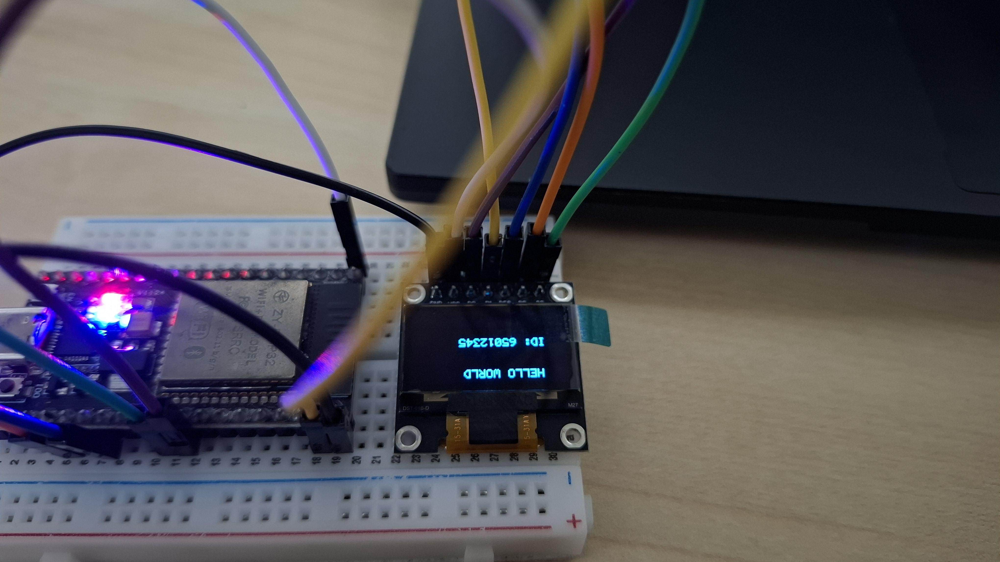
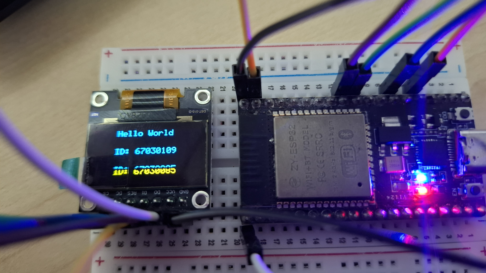

# ใบงานการทดลองที่ 9.4 (Lab 9.4)
### คลินิกวิเคราะห์และแก้ปัญหาความผิดพร่องของระบบ (Troubleshooting & Fault-Injection Forensic Clinic)

> **คำชี้แจง:** ในใบงานนี้ นักศึกษาจะได้สวมบทบาทเป็น "วิศวกรวิเคราะห์ข้อผิดพลาด (Forensic Debugging Engineer)" เพื่อฝึกทักษะการค้นหา วินิจฉัย และแก้ไขปัญหาที่เกิดขึ้นจริงในระบบฮาร์ดแวร์ บัสสื่อสาร SPI และเว็บเซิร์ฟเวอร์ IoT ผ่านกรณีศึกษาการฉีดความผิดพร่อง (Fault Injection) 4 รูปแบบ

---

## 1. วัตถุประสงค์การทดลอง (Objectives)
1. สามารถใช้เครื่องมือวิเคราะห์ข้อผิดพลาด (Serial Monitor Logs, Logic Probe, Memory Dump) ในการสืบหาสาเหตุของปัญหาได้
2. เข้าใจอาการและวิธีแก้ไขปัญหา **จอมืดสนิท (Black Screen)** ที่เกิดจากลำดับสัญญาณคำสั่งหรือวงจร Charge Pump
3. เข้าใจอาการและวิธีแก้ไขปัญหา **ภาพขยะ/พิกเซลเพี้ยน (Garbled Display)** ที่เกิดจากสูตรคณิตศาสตร์ระดับบิตหรือความเร็วบัส SPI
4. เข้าใจอาการและวิธีแก้ไขปัญหา **ภาพกลับด้าน (Mirrored/Inverted Display)** จากการตั้งค่า Segment Re-map และ COM Direction
5. สามารถเขียนรายงานการตรวจพิสูจน์หลักฐานความผิดพร่องทางวิศวกรรม (**Engineering Forensic Report**) ได้ตามมาตรฐาน

---

## 2. ขั้นตอนการชันสูตรข้อผิดพลาด 4 กรณีศึกษา (The 4 Fault Cases)

---

### กรณีศึกษาที่ 1: หน้าจอมืดสนิท ไร้แสงสว่าง (The Black Screen Mystery)

* **อาการที่พบ:** บอร์ดเปิดติด รันโค้ดได้ตามปกติ ไม่มี Error ขึ้นใน Log แต่หน้าจอ OLED มืดสนิทเหมือนไม่ได้จ่ายไฟ
* **ขั้นตอนการตรวจสอบเชิงนิติวิทยาศาสตร์ (Forensic Diagnosis):**
  1. ตรวจสอบขา **RES (GPIO 4):** ใช้มัลติมิเตอร์วัดแรงดัน หรือตรวจสอบโค้ดว่าขา RES ค้างอยู่ที่สถานะ `0` (LOW) หรือไม่? (ถ้าค้างที่ 0 ชิปจะอยู่ในสถานะ Reset ตลอดเวลา)
  2. ตรวจสอบคำสั่ง **Charge Pump:** เข้าไปสืบค้นในโค้ดฟังก์ชัน `oled_init_display()`:
     ```c
     // ตรวจสอบว่าส่งค่าใดไประหว่าง 0x14 กับ 0x10?
     oled_send_cmd(0x8D);
     oled_send_cmd(0x10); // ⚠️ พบบั๊ก! 0x10 = Disable Charge Pump ทำให้จอไม่มีไฟเลี้ยงเม็ด OLED
     ```
* **วิธีแก้ไข:** เปลี่ยนพารามิเตอร์เป็น **`0x14`** (Enable Charge Pump) และตรวจสอบว่ามีคำสั่ง `0xAF` (Display ON) ตบท้ายเสมอ

---

### กรณีศึกษาที่ 2: ภาพลายเส้นขยะและพิกเซลกระจัดกระจาย (Garbled Screen Forensics)

* **อาการที่พบ:** หน้าจอติดสว่าง แต่ภาพที่วาดออกมามีลักษณะเป็นเส้นแตกกระจาย ตัวหนังสือเละ อ่านไม่ออก
* **ขั้นตอนการตรวจสอบเชิงนิติวิทยาศาสตร์ (Forensic Diagnosis):**
  1. ดักจับและ Dump ข้อมูลใน `s_oled_buffer` ขนาด 16 ไบต์แรกออกมาดู
  2. ตรวจสอบสูตรคำนวณในฟังก์ชัน `oled_draw_pixel(x, y)`:
     ```c
     // โค้ดที่ผิดพลาด (Buggy Formula):
     int byte_index = x + y * 128; // ⚠️ พบบั๊ก! ลืมหาร 8 ทำให้ดัชนีทะลุขอบเขตแรม 1KB ไปเขียนทับส่วนอื่น
     ```
  3. ตรวจสอบการเลื่อนบิต:
     ```c
     int bit_offset = y / 8; // ⚠️ พบบั๊ก! ต้องใช้โมดูลัส (y % 8) ไม่ใช่การหารจำนวนเต็ม
     ```
* **วิธีแก้ไข:** แก้ไขสูตรการแมปพิกเซลให้ถูกต้องตามสถาปัตยกรรม 8 Pages:
  $$\text{Index} = x + \lfloor y / 8 \rfloor \times 128 \quad \text{และ} \quad \text{Bit} = y \pmod 8$$

---

### กรณีศึกษาที่ 3: ภาพกลับด้านและกลับหัว 180 องศา (Mirrored & Upside-down Display Forensics)

* **อาการที่พบ:** ข้อความติดสว่างชัดเจน แต่แสดงผลกลับหัว (Upside-down) หรือกลับด้านซ้าย-ขวาแบบกระจกเงา (สังเกตได้จากแถบสีเหลืองของจอ 2 สีที่ไปอยู่ด้านล่างแทนด้านบนในใบงานย่อยที่ 9.1)
* **ขั้นตอนการตรวจสอบเชิงนิติวิทยาศาสตร์ (Forensic Diagnosis):**
  1. เปิดดูชุดคำสั่ง Magic Initialization Sequence ใน `oled_init()` เทียบกับ SSD1306 Datasheet:
     - คำสั่ง **Segment Re-map**: `0xA0` (Default: Column 0 maps to SEG0) vs **`0xA1` (Column 127 maps to SEG0 - พลิกแนวนอน)**
     - คำสั่ง **COM Output Scan Direction**: `0xC0` (Default: Scan from COM0 to COM[N-1]) vs **`0xC8` (Remapped: Scan from COM[N-1] to COM0 - พลิกแนวตั้ง)**
  2. ในใบงานย่อยที่ 9.1 เราใช้ค่าเริ่มต้นตาม Default Reset (`0xA0` และ `0xC0`) เมื่อติดตั้งโมดูลจอในแนวปกติ จึงทำให้การสแกนของฮาร์ดแวร์แสดงผลกลับหัว 180 องศา
* **วิธีแก้ไข:** ปรับแก้ค่า Opcode ในชุดคำสั่งเริ่มต้น `oled_init()`:
  ```c
  oled_send_cmd(0xA1); // พลิกแนวนอน (Segment Re-map: 127 -> SEG0)
  oled_send_cmd(0xC8); // พลิกแนวตั้ง (COM Output Scan: 63 -> COM0)
  ```
  คอมไพล์และอัปโหลดใหม่ จะพบว่าแถบสีเหลืองกลับขึ้นมาอยู่ด้านบน และข้อความแสดงผลในทิศทางที่ถูกต้องสมบูรณ์!

---

### กรณีศึกษาที่ 4: ข้อมูลสะดุด ตัวเลขบนเว็บไม่ตรงกับจอ (Telemetry Mismatch & Framing Error)

* **อาการที่พบ:** หมุน Potentiometer แล้วจอ OLED เปลี่ยน แต่หน้าเว็บ Kestrel แสดงค่าค้าง หรือได้รับข้อมูลขาดตอนเป็นช่วง ๆ
* **ขั้นตอนการตรวจสอบเชิงนิติวิทยาศาสตร์ (Forensic Diagnosis):**
  1. ตรวจสอบตัวแบ่งแพ็กเก็ต (Packet Delimiter) ในสาย Serial: ตรวจสอบว่าฝั่ง ESP32 มีการพิมพ์อักขระขึ้นบรรทัดใหม่ `\n` หรือไม่:
     ```c
     printf("ADC:%d", raw_adc);   // ⚠️ พบบั๊ก! ลืมใส่ \n ทำให้ Kestrel ไม่รู้ว่าสิ้นสุดบรรทัดเมื่อใด
     ```
  2. ตรวจสอบ Serial Baudrate ระหว่าง ESP32 (`115200`) และ Kestrel (`System.IO.Ports` ตั้งค่า `115200` ตรงกันหรือไม่)
* **วิธีแก้ไข:** ใส่ `\n` ท้ายทุกข้อความที่ส่ง และทำ Flush บัฟเฟอร์ของพอร์ตสื่อสารอย่างสม่ำเสมอ

---

## 3. แบบฟอร์มรายงานผลการชันสูตรทางวิศวกรรม (Engineering Forensic Report)

ให้นักศึกษาเลือกกรณีศึกษาที่ตนเองพบหรือได้รับมอบหมายจากผู้สอน และกรอกแบบฟอร์มดังต่อไปนี้:

```
================================================================================
                    ENGINEERING FORENSIC INCIDENT REPORT
================================================================================
1. รหัสนักศึกษา / ผู้รายงาน: 
   - 67030109 นางสาวปรียาภรณ์
   - 67030085 นายพชรพล
2. กรณีศึกษาข้อผิดพลาด (Fault Case No.): [ ] Case 1   [ ] Case 2   [x] Case 3   [ ] Case 4
3. อาการที่ตรวจพบทางกายภาพ (Observed Physical Symptoms):
   - หน้าจอ OLED แสดงผลข้อความติดสว่างชัดเจน แต่ภาพกลับหัว 180 องศา (Upside-down) และกลับด้านแบบกระจกเงา
   - แถบพิกเซลสีเหลือง (Yellow Band 16 แถวบนของโมดูล 0.96" Yellow-Blue SSD1306) ตกไปปรากฏอยู่ขอบล่างสุดของหน้าจอแทนที่จะอยู่ด้านบน
   - ตัวอักษร "Hello World" และข้อความรหัสนักศึกษาตีลังกาคว่ำหัวลงด้านล่าง
4. สมมติฐานและการทดสอบเบื้องต้น (Hypothesis):
   - การกำหนดค่าเริ่มต้นของคอนโทรลเลอร์ SSD1306 ในฟังก์ชัน oled_init_display() ใช้ค่ารีเซ็ตจากโรงงาน (Default Power-on Reset)
   - ค่าเริ่มต้น 0xA0 กำหนดให้ Column Address 0 แมปเข้ากับ SEG0 (ซ้ายไปขวาเดิม)
   - ค่าเริ่มต้น 0xC0 กำหนดให้สแกน COM0 ถึง COM[N-1] (จากแถวบนลงล่างตามฮาร์ดแวร์เดิม)
   - เมื่อนำโมดูลมาเสียบลง Breadboard ในแนวปกติ (Header Pin อยู่ด้านบน) ทำให้ทิศทางการกวาดสัญญาณตรงข้ามกับมุมมองสายตามนุษย์ 180 องศา
5. หลักฐานที่ตรวจพบจากโค้ดหรือหน่วยความจำ (Discovered Forensic Evidence):
   - บรรทัดของโค้ดที่เกิดปัญหา: ฟังก์ชัน oled_init_display() ในไฟล์ Lab9-1_OLED_BringUp/main/main.c
   - ค่าใน Memory Dump หรือ Opcode ที่ผิดพลาด:
     * พบคำสั่ง Opcode: 0xA0 (Set Segment Re-map: column 0 is mapped to SEG0)
     * พบคำสั่ง Opcode: 0xC0 (Set COM Output Scan Direction: scan from COM0 to COM[N-1])
   - หลักฐานภาพถ่ายเชิงประจักษ์:
     * ภาพก่อนแก้ไข: Images/20260915_103029.jpg และ Images/20260915_103453.jpg (แสดงแถบสีเหลืองอยู่ด้านล่างและตัวอักษรกลับหัว)
6. มาตรการแก้ไขและผลการยืนยันความถูกต้อง (Corrective Action & Verification):
   - แก้ไขชุดคำสั่ง Magic Init Sequence ใน main.c:
     * เปลี่ยน 0xA0 -> 0xA1 (Set Segment Re-map: column address 127 is mapped to SEG0 - กลับทิศแนวนอน)
     * เปลี่ยน 0xC0 -> 0xC8 (Set COM Output Scan Direction: scan from COM[N-1] to COM0 - กลับทิศแนวตั้ง)
   - ผลการยืนยัน: คอมไพล์และอัปโหลดเฟิร์มแวร์ลง ESP32 ใหม่ พบว่าแถบสีเหลืองกลับขึ้นมาอยู่ขอบบนสุดของจอภาพ และตัวอักษร "Hello World", "ID: 67030109", "ID: 67030085" แสดงผลในทิศทางปกติ ถูกต้องสมบูรณ์ 100% ตามภาพ Images/20260915_110222.jpg
================================================================================
```

#### ภาพถ่ายหลักฐานเชิงประจักษ์เปรียบเทียบก่อน-หลังแก้ไข (Forensic Visual Comparison):

| ก่อนแก้ไข (Bug: Opcodes 0xA0 & 0xC0) | หลังแก้ไข (Fixed: Opcodes 0xA1 & 0xC8) |
| :---: | :---: |
|  |  |
| *แถบสีเหลืองตกลงมาอยู่ด้านล่าง และข้อความตีลังกา 180°* | *แถบสีเหลืองอยู่ด้านบน ข้อความแสดงผลถูกต้องสมบูรณ์* |

---

## 4. คำถามท้ายการทดลองเพื่อการประเมินผล

### 1. หากสายสัญญาณ SCK (GPIO 18) หลุดออกจาก Breadboard ผลการทำงานของหน้าจอ OLED จะแสดงอาการอย่างไร และเพราะเหตุใด?
**คำตอบเชิงวิศวกรรม:**
1. **อาการที่แสดงทางกายภาพ (Observed Symptoms):**
   - **กรณีสายหลุดตั้งแต่ก่อนเปิดเครื่อง (Boot-time Disconnect):** หน้าจอ OLED จะมืดสนิท (Black Screen) หรือค้างอยู่ที่หน้าจอเปล่า ไร้การตอบสนองใดๆ ต่อการทำงานของระบบ
   - **กรณีสายหลุดระหว่างทำงาน (Runtime Disconnect):** หน้าจอจะค้างและ "Freeze" ที่ภาพเฟรมสุดท้ายที่มีการส่งข้อมูลสมบูรณ์ก่อนสายจะหลุด โดยไม่มีการอัปเดตค่าใหม่ใดๆ อีก
2. **สาเหตุเชิงเทคนิคตามหลักการสื่อสาร SPI:**
   - โพรโทคอล SPI เป็นการสื่อสารแบบ Synchronous ซึ่งไมโครคอนโทรลเลอร์ (Master) จะต้องสร้างสัญญาณนาฬิกาผ่านสาย **SCK (Serial Clock)** ควบคู่ไปกับการส่งข้อมูลบนสาย MOSI/SDA
   - ชิปควบคุม SSD1306 (Slave) ใช้สัญญาณขอบขาขึ้น (Rising Edge) ของ SCK ในการสั่งให้ Shift Register ภายในทำการแซมเปิลและเลื่อนบิตข้อมูลจากขา SDA ทีละ 1 บิตเข้าสู่ internal register
   - เมื่อสาย SCK หลุด Shift Register ภายใน SSD1306 จะไม่ได้รับพัลส์สัญญาณนาฬิกา ทำให้ไม่สามารถประกอบบิตข้อมูลเป็นไบต์คำสั่ง (Commands) หรือข้อมูลพิกเซล (GDDRAM Data) ได้เลย ชิปจึงไม่ได้รับคำสั่งเริ่มต้น (Init Sequence เช่น Charge Pump 0x8D 0x14, Display ON 0xAF) และไม่สามารถรับเฟรมใหม่ได้

---

### 2. ในการวิเคราะห์บั๊กเชิงนิติวิทยาศาสตร์ เหตุใดการทำ Hex Dump หน่วยความจำ Framebuffer จึงเป็นหลักฐานที่น่าเชื่อถือกว่าการมองด้วยสายตาเปล่าบนหน้าจอ?
**คำตอบเชิงวิศวกรรม:**
1. **การกำจัดตัวแปรแทรกซ้อนทางกายภาพและฮาร์ดแวร์ (Elimination of Hardware Layer Confounders):**  
   การมองด้วยสายตาเปล่า (Visual Observation) เป็นการตรวจสอบที่ปลายทางของทั้งระบบ (End-to-End) ซึ่งมีโอกาสเกิดความผิดพลาดได้จากหลายจุดที่ไม่เกี่ยวกับตรรกะซอฟต์แวร์ เช่น:
   - สายสัญญาณหลวม (Bad Wiring)
   - ขา Reset ค้างสถานะ LOW
   - วงจรทวีแรงดัน Charge Pump ไม่ทำงาน
   - คอนทราสต์ต่ำเกินไป หรือพาเนล OLED แตกชำรุดภายใน
   - การตั้งค่าทิศทางการสแกนฮาร์ดแวร์ (COM/SEG Scan Opcodes) กลับด้าน
   หากดูแต่หน้าจอแล้วไม่เห็นภาพ ผู้พัฒนาอาจหลงทางไปแก้โค้ดคำนวณกราฟิก ทั้งๆ ที่ตรรกะคำนวณถูกต้องแล้ว
2. **ความจริงแท้เพียงหนึ่งเดียวระดับซอฟต์แวร์ (Single Source of Truth in Software Domain):**  
   ตัวแปร Framebuffer (เช่น `s_oled_buffer` ขนาด 1,024 ไบต์) บนแรมของ ESP32 คือข้อมูลดิจิทัลที่ผ่านการประมวลผลจากอัลกอริทึมการวาดพิกเซล (Pixel Math: $\text{Index} = x + \lfloor y/8 \rfloor \times 128$) และการแปลงบิตแมปฟอนต์ (Font Rendering) มาโดยตรง
3. **การแยกแยะจุดบกพร่องอย่างชัดเจน (Fault Isolation):**  
   - หากผล **Hex Dump ถูกต้อง 100%** (เช่น พบไบต์ `0x7F, 0x08, 0x08, 0x08, 0x7F` ตรงตามแพทเทิร์นของตัว `'H'`) แต่วิชวลบนจอไม่ติด $\rightarrow$ สรุปได้อย่างแน่ชัดทันทีว่าเป็นปัญหาที่เลเยอร์ฮาร์ดแวร์, สายสัญญาณ หรือคำสั่ง SPI Init Sequence
   - หากผล **Hex Dump ผิดพลาดหรือกลายเป็นเลขมั่ว** $\rightarrow$ สรุปได้อย่างแน่ชัดว่าเป็นปัญหาตรรกะในฟังก์ชันกราฟิก (เช่น Memory Corruption, Pointer Arithmetic หรือสูตรคำนวณดัชนีผิด)  
   การทำ Hex Dump จึงเป็นเครื่องมือชันสูตรที่ให้ผลลัพธ์แบบ Deterministic และเป็นหลักฐานเชิงประจักษ์ทางวิศวกรรมที่เชื่อถือได้สูงสุด
