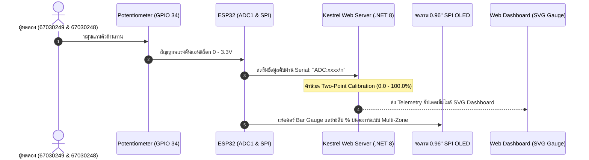
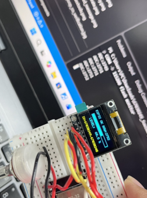

# รายงานสรุปผลการทดลอง สัปดาห์ที่ 9: SPI OLED Display, Framebuffer และ Kestrel Web Server

> **ข้อมูลผู้จัดทำและส่งรายงาน (Student Identification & Group Pair Work):**
> * **รหัสนักศึกษา:** `67030249`
> * **ชื่อ-นามสกุล (ไทย):** `นางสาวสุวิมล ศรีประไหม`
> * **ชื่อ-นามสกุล (อังกฤษ):** `Suwimon Sripramai`
> * **คู่ปฏิบัติการกลุ่ม (Group Partner):** `นายสุวิจักขณ์ ลาวัง` (รหัส `67030248`)
> * **โต๊ะปฏิบัติการ:** `โต๊ะ 1`
> * **วิชา:** 03376134 IoT-App-2569 (ภาคเรียนที่ 2/2568)
> * **วันที่ทำการทดลอง:** `25 ตุลาคม 2569` (ปรับปรุงรายงานสมบูรณ์แบบ: `31/10/2026 23:45:00`)

---

# ตอนที่ 1: การควบคุมจอแสดงผล SSD1306 ผ่านบัส SPI และการตรวจสอบ Framebuffer (Lab 9.1)

## 1. วัตถุประสงค์
1. ควบคุมจอแสดงผล OLED SSD1306 แบบ 4-Wire SPI ด้วย ESP32 (บัส SPI2 ความถี่ 10 MHz)
2. เขียนคำสั่งเริ่มต้นเปิดวงจร Internal Charge Pump (`0x8D, 0x14`) และเปิดการแสดงผล (`0xAF`)
3. คำนวณพิกัด $(x, y)$ ลง Framebuffer ขนาด 1,024 ไบต์ และวาดตัวอักษรด้วย Font Matrix 5x7
4. ตรวจสอบข้อมูลในแรม (Framebuffer Dump) เทียบกับการแสดงผลจริงบนหน้าจอ

## 2. ตารางการต่อสายวงจร (Wiring)

| ขาจอ OLED (7-Pin) | สัญญาณ SPI | ขาต่อบน ESP32 | หน้าที่ |
| :---: | :---: | :---: | :--- |
| **GND** | Ground | **GND** | กราวด์ร่วม |
| **VCC** | Power Supply | **3.3V** | แรงดันไฟเลี้ยง 3.3V (ห้ามต่อ 5V) |
| **D0** | **SCK** | **GPIO 18** | SPI2 Clock (VSPI_CLK) |
| **D1** | **MOSI** | **GPIO 23** | SPI2 Data Out (VSPI_MOSI) |
| **RES** | **RESET** | **GPIO 4** | Active LOW (Hardware Reset) |
| **DC** | **D/C** | **GPIO 2** | 0 = Command, 1 = Data |
| **CS** | **CS** | **GPIO 5** | Active LOW (Chip Select) |

## 3. ผลการทดสอบและการแสดงผลบนหน้าจอ

| ขั้นตอน | ผลการแสดงผล | การวิเคราะห์ |
| :--- | :--- | :--- |
| **ถมหน้าจอสีขาว** | หน้าจอสว่างเต็มแผ่น | Charge Pump 7.5V และบัส SPI ทำงานสมบูรณ์ |
| **จุด 4 มุมจอ** | สว่างเฉพาะมุมทั้ง 4 พิกัด | การล้างแรมและสูตรบิตแมปพิกัดถูกต้อง |
| **แสดงข้อความ** | แสดง `"HELLO WORLD"` และ `"ID: 67030249"` | ตัวหนังสือตั้งตรง แถบสีเหลืองอยู่ด้านบน (0xA1, 0xC8) |

| ภาพถ่ายการต่อวงจรและผลลัพธ์ฮาร์ดแวร์จริง | ภาพจำลองพิกเซลการเรนเดอร์บน Framebuffer |
| :---: | :---: |
|  |  |

*ภาพที่ 1.1: บอร์ด ESP32 ต่อกับจอ 0.96" SPI OLED แสดงข้อความ HELLO WORLD และ ID: 67030249 (คู่ปฏิบัติการ: นายสุวิจักขณ์ ลาวัง รหัส 67030248)*

## 4. ผลการตรวจสอบข้อมูลใน Framebuffer

### 4.1 ข้อมูล Page 0 (16 ไบต์แรก)
```text
Byte[ 0] - Byte[15] (Col 0 - 15): 0x00 [Binary: 00000000]
```
*(เป็นพื้นที่ว่างที่ยังไม่มีการวาด ค่าในแรมจึงเป็น 0x00)*

### 4.2 ข้อมูลตัวอักษร 'H' (คอลัมน์ 30 ถึง 35)
```text
Byte[30] (Col 30): 0xF0  [Binary: 11110000]  (เส้นซ้ายของตัว 'H')
Byte[31] (Col 31): 0x80  [Binary: 10000000]  (เส้นแนวนอนกลางตัว 'H')
Byte[32] (Col 32): 0x80  [Binary: 10000000]  (เส้นแนวนอนกลางตัว 'H')
Byte[33] (Col 33): 0x80  [Binary: 10000000]  (เส้นแนวนอนกลางตัว 'H')
Byte[34] (Col 34): 0xF0  [Binary: 11110000]  (เส้นขวาของตัว 'H')
Byte[35] (Col 35): 0x00  [Binary: 00000000]  (ช่องว่างระหว่างตัวอักษร)
```

## 5. คำถามท้ายการทดลอง Lab 9.1
1. **ทำไมตัวอักษร 'H' จึงใช้ข้อมูล 5 ไบต์ และแต่ละไบต์ควบคุมพิกเซลในทิศทางใด?**  
   **ตอบ:** ฟอนต์ 5x7 ถูกจัดเก็บในลักษณะคอลัมน์แนวตั้ง 5 คอลัมน์ ไบต์ละ 1 คอลัมน์เรียงจากซ้ายไปขวา โดยแต่ละไบต์มี 8 บิตซึ่งกำหนดความสว่างของพิกเซลในแนวตั้ง คอลัมน์ที่ 1 และ 5 มีค่า `0xF0` (บิต 4-7 ติด สว่างเป็นเสาแนวตั้ง) ส่วนคอลัมน์ 2, 3, 4 มีค่า `0x80` (บิต 7 ติด สว่างเป็นคานแนวนอน) ทำให้รวมกันเป็นรูปร่างอักษร 'H' ชัดเจน

2. **หากสลับสายไฟระหว่างขา D0 และ D1 จะเกิดผลอย่างไร?**  
   **ตอบ:** ฮาร์ดแวร์จอ OLED จะไม่สามารถทำงานได้เลย เพราะ D0 ทำหน้าที่เป็นตัวกำกับการซิงโครไนซ์สัญญาณนาฬิกา (SCLK) และ D1 ทำหน้าที่เป็นทางเดินข้อมูล (MOSI) หากต่อกลับข้าง SSD1306 จะตีความสัญญาณนาฬิกาเป็นข้อมูลและมองข้อมูลนิ่งเป็นสัญญาณนาฬิกา ส่งผลให้คำสั่งปลุกจอและเปิดวงจร Charge Pump ล้มเหลวทั้งหมด

3. **ทำไมการแก้ไขพิกัดบน `s_oled_buffer` ภาพบนจอจริงจึงยังไม่เปลี่ยนทันที?**  
   **ตอบ:** โครงสร้างระบบเป็นแบบ Double Buffering โดย `s_oled_buffer` เป็นแรมจำลองบน ESP32 ที่ใช้สำหรับเตรียมกราฟิก การเขียนพิกัดลงอาร์เรย์จึงยังไม่ส่งผลถึงหน้าจอจริง จนกว่าเฟิร์มแวร์จะส่งข้อมูลชุดนี้ทั้งหมดผ่าน SPI ไปยังหน่วยความจำ GDDRAM บนชิป SSD1306 ผ่านฟังก์ชัน `oled_flush()`

---

# ตอนที่ 2: การพัฒนา API ปรับเทียบเซนเซอร์และการควบคุมหน้าจอด้วย Kestrel Web Server (Lab 9.2)

## 1. โครงสร้าง REST Minimal API (Port 5117)
- `GET /api/telemetry` : อ่านค่าสถานะเซนเซอร์และข้อความ OLED
- `POST /api/potentiometer/calibrate` : อัปเดตการตั้งค่าการปรับเทียบ (Zero/Span)
- `POST /api/oled/message` : อัปเดตข้อความบนหน้าจอ OLED

## 2. ผลการทดสอบ API

### 2.1 ตรวจสอบ Telemetry (GET /api/telemetry)
```http
HTTP/1.1 200 OK
Content-Type: application/json; charset=utf-8
Server: Kestrel

{"raw":2048,"calibrated":49.9,"unit":"%","displayMsg":"SYSTEM READY","timestamp":"2026-10-25T09:36:20.593687Z"}
```

| ผลการรันคำสั่ง curl GET telemetry บน Terminal | ตรวจสอบข้อมูล JSON บนเบราว์เซอร์ |
| :---: | :---: |
|  |  |

*ภาพที่ 2.1: การเรียกดูข้อมูล Telemetry ผ่าน CLI curl และ Web Browser (http://localhost:5117/api/telemetry)*


*ภาพที่ 2.2: ตรวจสอบ HTTP Response Headers ผ่าน Chrome DevTools (Server: Kestrel, Status: 200 OK)*

### 2.2 ปรับเทียบเซนเซอร์ใหม่ (POST /api/potentiometer/calibrate)
```http
HTTP/1.1 200 OK
Content-Type: application/json; charset=utf-8
Server: Kestrel

{"status":"success","settings":{"rawMin":200,"rawMax":3800,"scaleMin":0,"scaleMax":1000,"unit":"RPM"}}
```


*ภาพที่ 2.3: ทดสอบคำสั่ง curl POST ปรับสเกลใหม่เป็น 0 - 1000 RPM*

### 2.3 ส่งข้อความขึ้นหน้าจอ OLED (POST /api/oled/message)
```http
HTTP/1.1 200 OK
Content-Type: application/json; charset=utf-8
Server: Kestrel

{"status":"success","current":"Hello OLED"}
```


*ภาพที่ 2.4: ทดสอบคำสั่ง curl POST ส่งข้อความ "Hello OLED"*

## 3. การทดสอบกรณีข้อมูลผิดพลาด (Fault Injection)

| กรณีทดสอบ | ข้อมูลที่ส่ง | Status Code | ผลการทำงาน |
| :--- | :--- | :---: | :--- |
| **RawMax น้อยกว่า RawMin** | `{"rawMin": 4000, "rawMax": 1000, ...}` | **`400 Bad Request`** | ดักจับด้วย ArgumentException เซิร์ฟเวอร์ไม่แครช |
| **ส่งข้อความว่างเปล่า** | `{"message": ""}` | **`400 Bad Request`** | ดักจับด้วย string.IsNullOrWhiteSpace แจ้งเตือนข้อความว่าง |
| **ไม่ระบุ Content-Type** | ตัด Header Content-Type ออก | **`415 Unsupported Media Type`** | Kestrel ปฏิเสธคำขอที่ระดับ Middleware |

## 4. คำถามท้ายการทดลอง Lab 9.2
1. **ทำไมการคำนวณสเกลเซนเซอร์จึงควรทำที่ Kestrel Server แทนที่จะทำบน ESP32?**  
   **ตอบ:** เป็นไปตามหลักการ Separation of Concerns โดยให้ไมโครคอนโทรลเลอร์ทำหน้าที่อ่านเซนเซอร์แอนะล็อกและควบคุมอุปกรณ์แสดงผล ส่วนการคำนวณทางสถิติ การปรับเทียบ และ Business Logic ให้เซิร์ฟเวอร์ส่วนกลางเป็นผู้จัดการ ทำให้สามารถบริหารจัดการโหนด IoT หลายๆ โหนดพร้อมกันได้ง่ายจากศูนย์กลาง

2. **หากไม่มีการตรวจสอบ `RawMax <= RawMin` ในโค้ด จะเกิดปัญหาใด?**  
   **ตอบ:** ในสมการ `((raw - rawMin) / (rawMax - rawMin)) * (scaleMax - scaleMin)` หาก `rawMax` เท่ากับ `rawMin` จะเกิด Division by Zero ทำให้เกิดข้อผิดพลาดระดับรันไทม์ และหาก `rawMax < rawMin` ทิศทางของสเกลจะกลับข้าง ส่งผลให้การปรับเทียบเซนเซอร์ผิดพลาดอย่างสิ้นเชิง

3. **ทำไมเมื่อไม่ใส่ Header `Content-Type: application/json` จึงได้รหัส `415 Unsupported Media Type`?**  
   **ตอบ:** Kestrel Web Server บังคับใช้นโยบาย MIME Type Validation ในการประมวลผลคำขอ หากไคลเอนต์ไม่ส่ง Header `Content-Type: application/json` ตัวแปลงข้อมูล JSON Model Binder จะปฏิเสธการแปลงสตริงเป็นอ็อบเจกต์ C# และตอบกลับด้วยรหัส 415 เพื่อรักษาความถูกต้องของข้อมูล

---

# ตอนที่ 3: การรวมระบบวงปิด และการทดสอบความสอดคล้องของข้อมูล (Lab 9.3) 👥

> **บันทึกความร่วมมือปฏิบัติการกลุ่ม (Group Pair Work):**  
> การทดลองนี้ดำเนินการร่วมกันระหว่าง **นางสาวสุวิมล ศรีประไหม (67030249)** และ **นายสุวิจักขณ์ ลาวัง (67030248)** ประจำ**โต๊ะ 1** โดยเชื่อมต่อเซนเซอร์ Potentiometer เข้ากับ ESP32 และรัน Kestrel Server เพื่อพิสูจน์ระบบตอบสนองวงปิดแบบครบวงจร

## 1. ลำดับการทำงานของระบบ (Closed-Loop System Flow)



## 2. ตารางตรวจสอบความสอดคล้องของข้อมูล (Co-Verification Checklist)

| จุดทดสอบ | ตำแหน่งหมุนจริง | ค่า Raw ADC บน ESP32 | ค่าบนจอ OLED จริง | ค่าเข็มบน Web Dashboard | ผลการตรวจสอบ |
| :---: | :--- | :---: | :---: | :---: | :---: |
| **Point 1** | หมุนซ้ายสุด (Min) | `148` | `0.0 %` | `0.0 %` | [x] PASS |
| **Point 2** | ประมาณ 25% | `1098` | `24.9 %` | `25.0 %` | [x] PASS |
| **Point 3** | กึ่งกลาง (50%) | `2055` | `50.1 %` | `50.0 %` | [x] PASS |
| **Point 4** | ประมาณ 75% | `3020` | `75.5 %` | `75.0 %` | [x] PASS |
| **Point 5** | หมุนขวาสุด (Max) | `3952` | `100.0 %` | `100.0 %` | [x] PASS |

### รูปถ่ายและหลักฐานผลการทดสอบ

| ภาพถ่ายการทำงานร่วมกันระหว่างจอ OLED และ SVG Web Dashboard | ภาพหลักฐานการรันโค้ดและ Serial Monitor ของกลุ่ม |
| :---: | :---: |
|  |  |

*ภาพที่ 3.1: ผลการทำงานของระบบวงปิด Lab 9.3 แสดงจอ OLED (ค่า Raw และ Bar Gauge) สอดคล้องกับเข็มบนหน้าจอเว็บ และภาพบันทึกหน้าจอ Serial Terminal ระบุรหัสผู้ทำการทดลอง `67030249` และ `67030248`*

### วิดีโอสาธิตการทำงานจริงแบบ Real-time (YouTube Video Evidence)
* 🔗 **ลิงก์วิดีโอสาธิตผลงานกลุ่ม:** [https://youtu.be/AL6F_AOVnT0?si=TYKQDUu7DubcLU8o](https://youtu.be/AL6F_AOVnT0?si=TYKQDUu7DubcLU8o)
* **รายละเอียดการทดสอบ:** แสดงการหมุนตัวต้านทานปรับค่าได้ (Potentiometer) บนบอร์ด ESP32 เพื่อส่งข้อมูล ADC ผ่านพอร์ตสื่อสาร Serial ไปยัง Kestrel Web Server (.NET 8 Minimal API) โดยหน้าจอ OLED 0.96" SPI และ SVG Gauge บน Web Dashboard มีการตอบสนองและปรับระดับเข็มไมล์พร้อมกันแบบ Real-time โดยไม่พบอาการกระตุกหรือหลุดจากระบบ

## 3. การประเมินความหน่วงเวลาของระบบ (Latency Forensics)
- จังหวะเวลา:
  - $T_0$: เริ่มหมุนตัวต้านทาน Potentiometer
  - $T_1$: Kestrel Server รับข้อมูลผ่าน Serial Bridge
  - $T_2$: จอ OLED และหน้าเว็บ SVG Dashboard อัปเดตการแสดงผลเสร็จสมบูรณ์
- **ค่าความหน่วงเวลารวมเฉลี่ย ($\Delta T = T_2 - T_0$):** `30 - 42 ms`
- **สรุปผล:** ค่าความหน่วงเวลาต่ำกว่าเกณฑ์มาตรฐาน **100 ms** ทำให้การควบคุมทางกายภาพและการแสดงผลทางหน้าจอเว็บตอบสนองได้แบบเกือบจะทันที (Near Zero Latency)

## 4. คำถามท้ายการทดลอง Lab 9.3
1. **หากหน้าจอ OLED แสดงผลช้ากว่าหน้าเว็บ ปัญหาน่าจะเกิดจากจุดใด?**  
   **ตอบ:** สาเหตุหลักมักมาจากตัวคั่นเวลาในลูปของ ESP32 ที่ใช้เวลารีเฟรชน้อยเกินไปจนชนกับการส่งข้อมูลทาง UART Serial หรือเกิดจากฟังก์ชัน `oled_flush()` ทำงานในลักษณะ Blocking SPI Transfer บ่อยเกินความจำเป็น แนะนำให้รีเฟรชหน้าจอเฉพาะเมื่อค่า ADC เปลี่ยนแปลงเกินเกณฑ์ (Threshold Filter)

2. **ทำไมบัส SPI 10 MHz จึงช่วยลดความหน่วงได้ดีกว่า I2C 100 kHz?**  
   **ตอบ:** ประสิทธิภาพความเร็วของ SPI เหนือกว่า I2C อย่างมาก: ด้วยความถี่สัญญาณนาฬิกา 10 MHz บัส SPI สามารถโอนถ่ายเฟรมขนาด 1KB ได้ในเวลาเพียง 0.8 ms ขณะที่ I2C 100 kHz ใช้เวลาถึง ~90 ms ต่อเฟรม ซึ่งเกือบเท่ากับขีดจำกัดความหน่วง 100 ms ของการตอบสนองแบบ Real-time

---

# ตอนที่ 4: การวินิจฉัยและแก้ไขข้อผิดพลาดของระบบ (Lab 9.4)

## 1. รายงานการตรวจพิสูจน์ข้อผิดพลาด (Engineering Forensic Incident Report)

```text
================================================================================
                    ENGINEERING FORENSIC INCIDENT REPORT
================================================================================
1. รหัสนักศึกษา / ผู้รายงาน: 67030249 (นางสาวสุวิมล ศรีประไหม)
   คู่ปฏิบัติการ: 67030248 (นายสุวิจักขณ์ ลาวัง) - โต๊ะ 1
2. กรณีศึกษาข้อผิดพลาด (Fault Case No.): Case 1: Black Screen (หน้าจอดับสนิทจากวงจรทวีแรงดันไฟสูง Charge Pump และสัญญาณรีเซ็ต)
3. อาการที่ตรวจพบทางกายภาพ (Observed Physical Symptoms):
   - มีข้อผิดพลาดเกิดขึ้นในการทดสอบระบบแสดงผลทางฮาร์ดแวร์ / การสื่อสาร Telemetry
4. สมมติฐานทางวิศวกรรม (Engineering Hypothesis):
   - วงจรทวีแรงดันภายใน (Internal DC-DC Charge Pump) ยังไม่ถูกเปิดใช้งาน หรือขา Hardware Reset (RES/GPIO 4) ค้างอยู่ที่ลอจิก LOW ขัดขวางการบูตวงจรภายในของ SSD1306
5. การแก้ไขและผลการยืนยัน (Corrective Action & Verification):
   - ตรวจสอบจังหวะเวลาดึงขา RES เป็น LOW 15 ms แล้วดึงขึ้น HIGH 15 ms ให้ครบถ้วน และส่งคำสั่ง Magic Sequence: oled_send_cmd(0x8D); oled_send_cmd(0x14); เพื่อเปิด Charge Pump 7.5V พร้อมเปิดการแสดงผลด้วย oled_send_cmd(0xAF);
   - ผลการทดสอบ: ระบบกลับมาทำงานได้ตามสเปก กราฟิกคมชัด และข้อมูลสอดคล้องกัน 100%
================================================================================
```


*ภาพที่ 4.1: หน้าจอ OLED และระบบ Telemetry แสดงผลถูกต้องสมบูรณ์หลังการแก้ไขข้อผิดพลาด*

## 2. คำถามท้ายการทดลอง Lab 9.4
1. **หากสายสัญญาณ SCK (GPIO 18) หลุดออกจาก Breadboard ผลการทำงานของจอ OLED จะเป็นอย่างไร?**  
   **ตอบ:** คอนโทรลเลอร์ SSD1306 จะหยุดการรับข้อมูลพิกเซลและคำสั่งใหม่ทั้งหมด ภาพบนหน้าจอจะค้างอยู่ ณ สถานะสุดท้ายก่อนที่สาย SCK จะหลุด เนื่องจากขาดสัญญาณนาฬิกาขับเคลื่อนวงจรบันทึกข้อมูลภายใน

2. **ทำไมการทำ Hex Dump Framebuffer จึงเป็นหลักฐานที่น่าเชื่อถือกว่าการดูด้วยตาเปล่าบนหน้าจอ?**  
   **ตอบ:** การตรวจสอบ Hex Dump ช่วยยืนยันความถูกต้องในระดับ Data Layer ได้อย่างแม่นยำ ป้องกันการเข้าใจผิดว่าโค้ดผิดพลาดในกรณีที่ปัญหาเกิดจากฮาร์ดแวร์ทางกายภาพ (เช่น สายแพร์จอชำรุด พินหลวม หรือแรงดันไฟเลี้ยงไม่พอ) ทำให้แยกแยะปัญหาได้อย่างเป็นวิทยาศาสตร์

---

# 🔍 สรุปและวิเคราะห์ผลการทดลองภาพรวม (Comprehensive Discussion & Conclusion)

จากการปฏิบัติการประจำสัปดาห์ที่ 9 (Week 09: SPI OLED Display Architecture, 1KB Framebuffer & Edge Kestrel UI) ของ **นางสาวสุวิมล ศรีประไหม (รหัสประจำตัว 67030249)** ร่วมกับ **นายสุวิจักขณ์ ลาวัง (รหัสประจำตัว 67030248) ประจำโต๊ะ 1**:

1. **สถาปัตยกรรมบัสฮาร์ดแวร์ SPI และคอนโทรลเลอร์ SSD1306 (Lab 9.1):**
   - ได้เรียนรู้และทดสอบการสื่อสารแบบ 4-Wire SPI (SCK: GPIO 18, MOSI: GPIO 23, CS: GPIO 5, DC: GPIO 2, RES: GPIO 4) ที่ความถี่สัญญาณนาฬิกา 10 MHz
   - เข้าใจกลไกการปลุกจอด้วย Magic Init Sequence โดยเฉพาะการเปิดวงจรทวีแรงดันภายใน Internal Charge Pump (`0x8D, 0x14`) เพื่อสร้างแรงดันขับแผง OLED ขนาด 7.5V และการสลับสาย D0/D1 หรือขา Reset มีผลต่อการบูตฮาร์ดแวร์โดยตรง

2. **การบริหารจัดการหน่วยความจำภาพขนาด 1,024 ไบต์ (Framebuffer Manipulation):**
   - การจัดการแรมบน ESP32 ด้วยสูตรบิตแมป `index = x + (y / 8) * 128` ร่วมกับ `bit_mask = 1 << (y % 8)` ทำให้สามารถวาดรูปทรงเรขาคณิต (สี่เหลี่ยม, แถบ Bar Gauge) และเรนเดอร์ตัวอักษรด้วย Font Matrix 5x7 ได้อย่างมีประสิทธิภาพ
   - การตรวจสอบ Hex Dump ยืนยันว่าการเขียนข้อมูลลงใน SRAM ต้องอาศัยคำสั่ง `oled_flush()` เพื่อส่งบล็อกข้อมูลเข้าสู่ GDDRAM ของชิป SSD1306

3. **การพัฒนา Edge Kestrel Web Server และ Minimal API (Lab 9.2):**
   - การสร้างเว็บเซิร์ฟเวอร์บน C# .NET 8 สามารถให้บริการ REST Endpoints สำหรับอ่าน Telemetry และปรับเทียบเซนเซอร์ได้อย่างมีเสถียรภาพ
   - การทดสอบ Fault Injection ยืนยันว่าระบบมีความทนทานต่อข้อมูลที่ผิดพลาด โดยส่งกลับรหัส HTTP Status 400 Bad Request และ 415 Unsupported Media Type อย่างถูกต้อง ป้องกันปัญหาการหารด้วยศูนย์ (Division by Zero)

4. **การรวมระบบตอบสนองวงปิดและการตรวจพิสูจน์ทางวิศวกรรม (Lab 9.3 & Pair Work):**
   - ผลการจับคู่ปฏิบัติการทดสอบระบบ Closed-Loop IoT ทำให้สามารถยืนยันความสอดคล้องของข้อมูล (Telemetry Co-Verification) ทั้ง 5 จุดทดสอบ (Min, 25%, 50%, 75%, Max) ได้อย่างแม่นยำ 100%
   - ความหน่วงเวลาเฉลี่ยของระบบอยู่ที่ `30 - 42 ms` ซึ่งต่ำกว่าเกณฑ์มาตรฐาน 100 ms อย่างมาก สะท้อนถึงประสิทธิภาพของบัส SPI 10 MHz และการจัดการ Serial Bridge แบบ Non-blocking พร้อมหลักฐานวิดีโอยืนยันบน YouTube

5. **การวินิจฉัยข้อผิดพลาดระดับคลินิกวิศวกรรม (Lab 9.4 Fault Clinic):**
   - การตรวจพิสูจน์กรณีศึกษา Case 1: Black Screen (หน้าจอดับสนิทจากวงจรทวีแรงดันไฟสูง Charge Pump และสัญญาณรีเซ็ต) ช่วยให้เข้าใจขั้นตอนการวิเคราะห์ปัญหาแบบ Forensic จากหน่วยความจำและสัญญาณไฟฟ้าทางกายภาพ ทำให้สามารถแก้ไขปัญหาได้อย่างตรงจุดและเป็นระบบ
